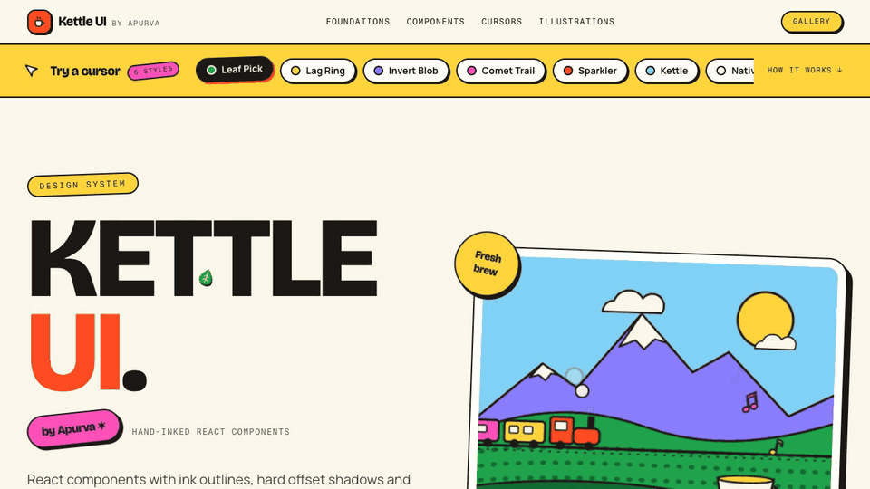
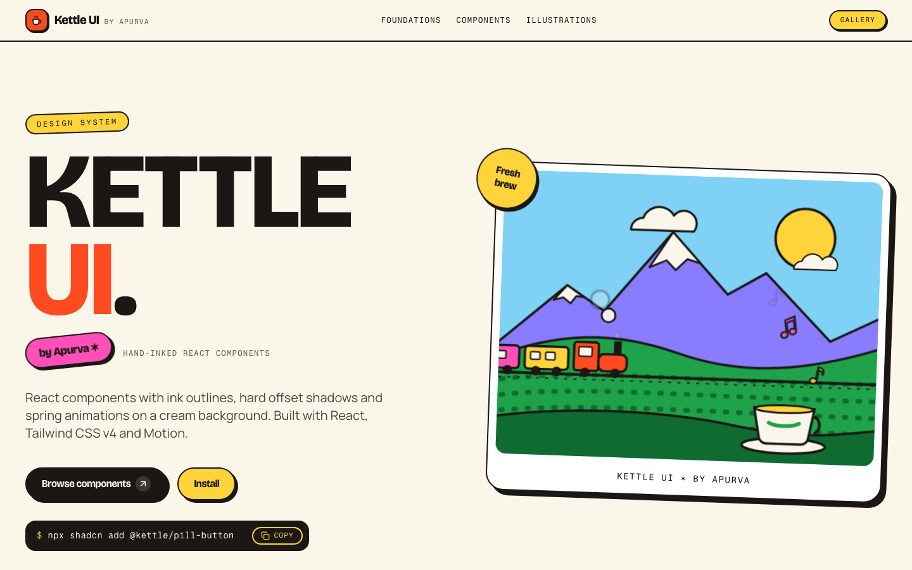
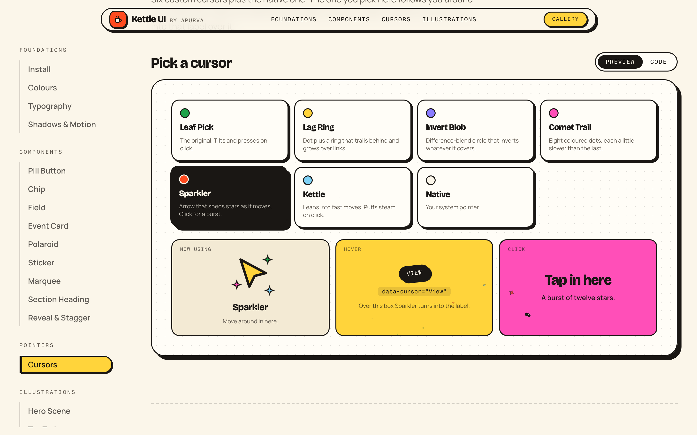
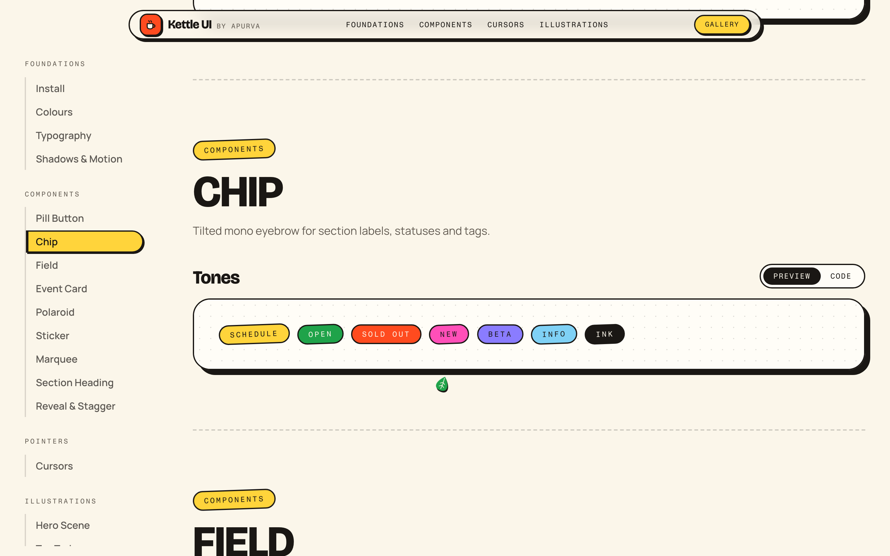
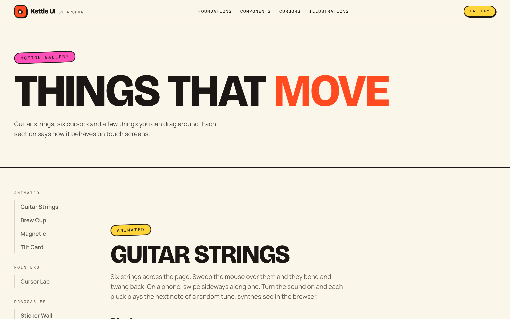
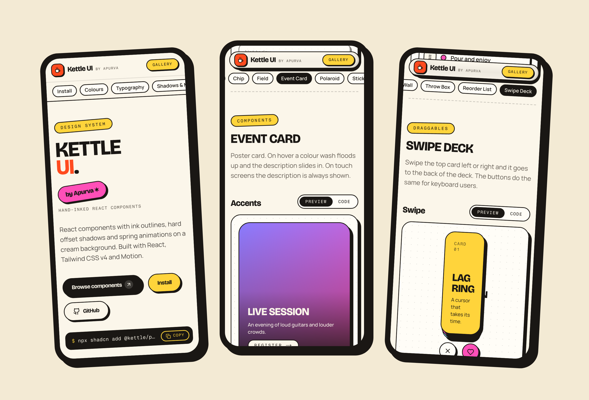

# Kettle UI
Playful React components for shadcn projects that copy into your app with one command.
```bash
npx shadcn@latest add https://raw.githubusercontent.com/apurvamukherjee/kettle-ui/main/public/r/kettle-all.json
```


**Live demo:** https://kettle-ui.vercel.app

<p align="center">
  
</p>

<p align="center">
  <a href="https://kettle-ui.vercel.app"></a>
</p>

<p align="center">
  <a href="https://github.com/apurvamukherjee/kettle-ui/actions/workflows/ci.yml"></a>
  
  
  
  
  
  
</p>

<p align="center">
  <a href="https://kettle-ui.vercel.app">Live site</a> ·
  <a href="#install">Install</a> ·
  <a href="#components">Components</a> ·
  <a href="#cursor-lab">Cursors</a> ·
  <a href="#motion-gallery">Gallery</a> ·
  <a href="#how-the-registry-works">Registry</a>
</p>

<br />

<p align="center">
  
</p>

<p align="center">
  
</p>

| 21 components | 6 cursors | 10 colours | 1 train |
| :---: | :---: | :---: | :---: |
| buttons, cards, fields, tickers, draggables | one pick follows you round the site | CSS variables mapped into Tailwind | preloader, hero scene and stepper |

## Install

Kettle UI is a [shadcn registry](https://ui.shadcn.com/docs/registry). The CLI copies each component's source into your project along with its npm packages, the colour tokens and the keyframes it uses. The code is then yours to change.

**1. Set up shadcn** (skip if you already have a `components.json`):

```bash
npx shadcn@latest init
```

**2. Add the registry** to `components.json`:

```json
{
  "registries": {
    "@kettle": "https://raw.githubusercontent.com/apurvamukherjee/kettle-ui/main/public/r/{name}.json"
  }
}
```

**3. Add components:**

```bash
npx shadcn@latest add @kettle/pill-button @kettle/cursor
npx shadcn@latest add @kettle/kettle-all     # everything
```

You can skip step 2 and install straight from a URL:

```bash
npx shadcn@latest add https://raw.githubusercontent.com/apurvamukherjee/kettle-ui/main/public/r/pill-button.json
```

**Fonts.** The theme uses Bricolage Grotesque for display text and Fragment Mono for labels. Load them with `next/font` and expose them as `--font-bricolage` and `--font-fragment-mono`. Without them it falls back to system fonts.

## Palette

<p align="center">
  
</p>

Every colour is a CSS variable mapped into Tailwind, so you write `bg-tunes`, `text-ink` or `border-ink`. Shadows are `shadow-hard` and `shadow-hard-lg`, and the two easings are `--ease-bounce` and `--ease-out-expo`.

## Components

| Name | What it does |
| --- | --- |
| `pill-button` | Pill with a hard shadow. A second colour floods up on hover and the arrow hops. Uses `next/link`. |
| `chip` | Tilted mono label in eight tones. |
| `field` | Labelled input with hint and error states. |
| `event-card` | Poster card with a colour wash on hover. Shows the description by default on touch screens. |
| `polaroid` | Instant-photo frame with a caption strip. |
| `section-heading` | Eyebrow, word-by-word reveal title and subtitle. |
| `split-words` | The masked word reveal on its own. |
| `reveal` | `Reveal` and `Stagger` scroll entrances. |
| `sticker` | Tilted sticker that bobs and can be dragged with a mouse. |
| `marquee` | Infinite ticker. Follows scroll speed on desktop, pure CSS on touch screens. |
| `pluck-strings` | Guitar strings you can strum. Optional sound, synthesised in the browser. |
| `brew-cup` | Cup-of-tea loader in CSS keyframes. |
| `magnetic` | Wrapper that leans toward the mouse. |
| `tilt-card` | 3D tilt with a sliding glare. |
| `hero-scene` | Animated SVG of a toy train crossing hills below a mountain. |
| `toy-train` | The train on its own, chugging in CSS. |
| `train-stepper` | Ticket-stub step picker. The train rolls to the selected step. |
| `cursor` | Custom cursor with six variants and `data-cursor` labels. |
| `throw-box` | Box of items you can fling. They bounce off the walls. |
| `reorder-list` | List you reorder by dragging a grip. |
| `swipe-deck` | Card deck you swipe left or right, with buttons for keyboards. |

Hooks and helpers come along automatically when a component needs them: `use-on-screen`, `use-fine-pointer`, `tf` and `leaf-pick`.

## Cursor lab

<p align="center">
  
</p>

Leaf Pick, Lag Ring, Invert Blob, Comet Trail, Sparkler and Kettle. Pick one from the strip above the hero or from the lab and it follows you across every page. The three boxes under the lab show the selected cursor, the label it turns into over a `data-cursor` element, and what clicking does.

```tsx
import { Cursor } from "@/components/cursor/Cursor";

<Cursor variant="trail" />
<a href="/work" data-cursor="View">Case study</a>
```

Cursors and mouse dragging switch off on touch screens, and every loop respects `prefers-reduced-motion`.

## The docs site

<p align="center">
  
</p>

**Floating dock.** Scroll past the top and the header shrinks into a rounded pill 16px below the browser edge. Back at the top it opens out again. Both states are the same height, so the page never jumps.

**Scroll-spy.** The sidebar highlights the section you are reading with a sliding sun pill. On phones the section chips do the same and keep the active chip centred. It is right on first load, on `#hash` links, after a refresh and after the back button.

<p align="center">
  
</p>

**Train preloader.** Plain CSS, so it plays before any JavaScript arrives. About a second and a half, once per tab, and skipped entirely with reduced motion.

## Motion gallery

<p align="center">
  
</p>

The `/gallery` page has guitar strings you can strum, the brew cup loader, magnetic and tilt effects, the cursor lab and four draggables: a sticker wall, a throw box, a reorder list and a swipe deck.

## On every screen

<p align="center">
  
</p>

Checked in Chrome at 320, 375, 414, 768, 1024, 1280, 1440, 1920 and 2560px wide: no sideways scrolling at any depth, no console errors, no broken images or dead links, and tap targets of at least 24px on phones.

## Run the docs locally

```bash
git clone https://github.com/apurvamukherjee/kettle-ui.git
cd kettle-ui
npm install
npm run dev          # http://localhost:3000
```

| Script | |
| --- | --- |
| `npm run build` | Static export to `out/` |
| `npm run typecheck` | `tsc --noEmit` |
| `npm run lint` | ESLint |
| `npm run registry` | Rebuilds `registry.json` and `public/r/*.json` |

Link previews need absolute image URLs. Vercel fills these in on its own. On any other host, build with `SITE_URL=https://your-domain.com npm run build`.

## How the registry works

`scripts/build-registry.mjs` lists every item with its npm and registry dependencies and writes `registry.json`. `shadcn build` turns that into one JSON file per item in `public/r/`, with the source inlined. Every item depends on `kettle-theme`, which carries the CSS variables and keyframes, so a single `add` produces a component that renders correctly.

To serve the registry from somewhere else, set `REGISTRY_URL` before rebuilding:

```bash
REGISTRY_URL=https://your-domain.com/r npm run registry
```

```
components/
  kit/            PillButton, Chip, Field, EventCard, Polaroid, SectionHeading
  motion/         Sticker, Marquee, Reveal, SplitWords, PluckStrings, BrewCup, Magnetic, TiltCard
  illustrations/  HeroScene, ToyTrain, TrainStepper
  cursor/         Cursor, LeafPick
  drag/           ThrowBox, ReorderList, SwipeDeck
  docs/           the documentation site, cursor lab, dock and preloader
app/globals.css   tokens, shadows, easings, keyframes
public/r/         built registry (generated)
```

## Contributing

See [CONTRIBUTING.md](CONTRIBUTING.md). Questions go to [Discussions](https://github.com/apurvamukherjee/kettle-ui/discussions), bugs to [Issues](https://github.com/apurvamukherjee/kettle-ui/issues).

## License

[MIT](LICENSE)

<br />

<p align="center"><sub>Designed and built by Apurva Mukherjee.</sub></p>
